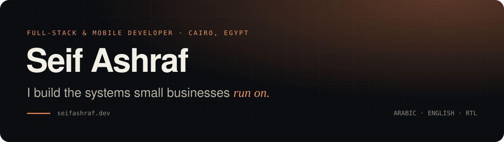
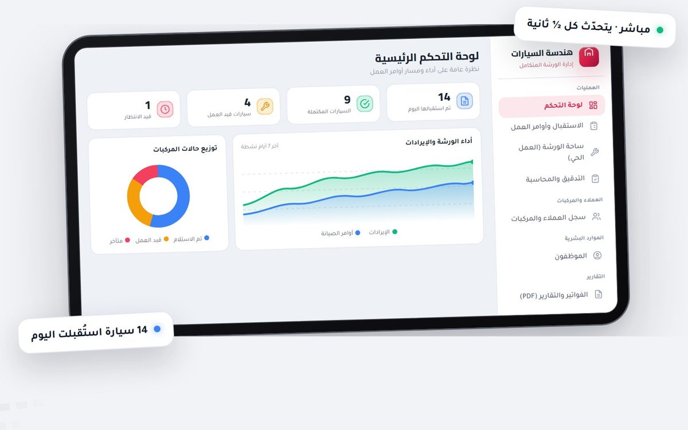
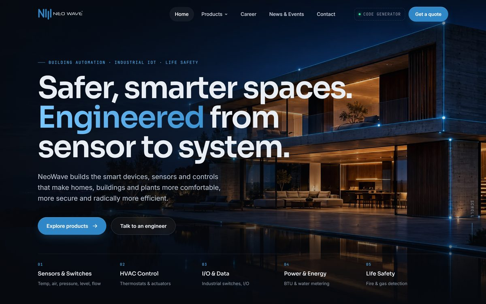
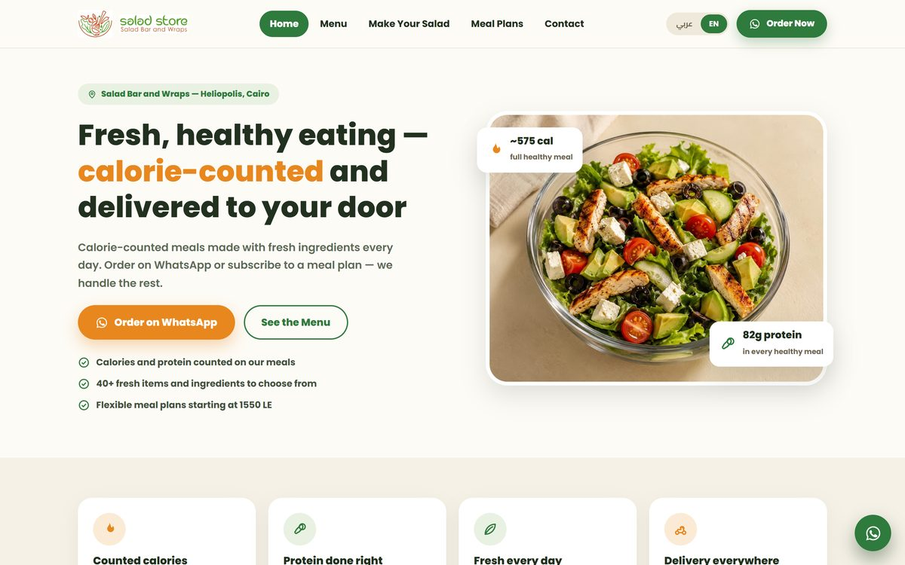
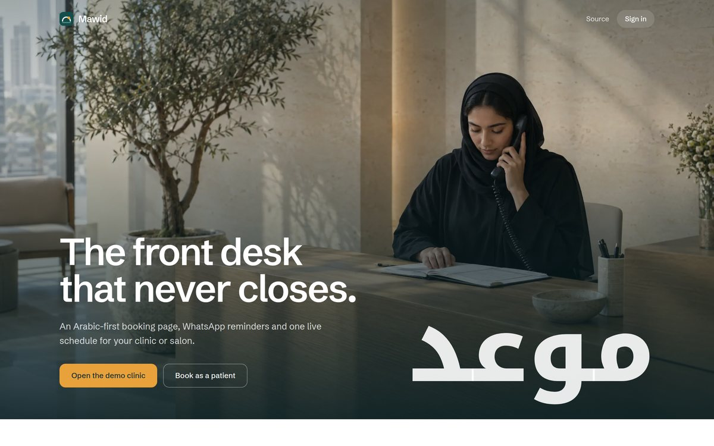

## About me

I'm a full-stack and mobile developer in Cairo with three years of experience shipping production software end to
end, from database design to the last pixel of the UI. I build live social apps, business platforms and client
websites with **React, Next.js, React Native, Laravel and Supabase**.

Arabic-first and bilingual **Arabic/English** builds with proper right-to-left layout are a specialty. I work in short
cycles: clients see working software in the first weeks, and we adjust while changes are still cheap.

- 📱 **Now:** Full-stack mobile developer at **LinkUp**, a live audio-room social app (React Native, Firebase, Agora)
- 🛒 **Building:** **Yanal Tech**, an e-commerce and operations platform for a tech retail and telecom company (Laravel, Filament)
- 🧰 **Freelance:** websites, booking systems and back-office software for small businesses, from scoping to support
- 🌍 **Languages:** Arabic (native), English (professional)

## Featured work

<table>
  <tr>
    <td width="50%" valign="top">
      
      <h3>Car Engineering Center</h3>
      <b>IN PRODUCTION · 4 BRANCHES</b>
      
The Arabic-first platform a car-workshop chain in Iraq runs on every day: work orders priced from inspection checklists, a live workshop floor with per-car countdowns, QR invoices customers track without logging in, and payroll from biometric attendance.

      
<code>Next.js</code> <code>React 19</code> <code>TypeScript</code> <code>Supabase</code> 34 screens · 12 tables · ~29,500 lines · 309 commits

    </td>
    <td width="50%" valign="top">
      
      <h3>NeoWave</h3>
      <b>LIVE · WEBSITE + PRODUCT CONFIGURATOR</b>
      
A full rebuild of an industrial IoT manufacturer's website with an editorial motion system, plus a database-backed product code generator and its own admin: 35 models, 460 options, publish without a redeploy.

      
<code>JavaScript</code> <code>GSAP</code> <code>Node.js</code> <code>PostgreSQL</code> <code>Vercel</code>

    </td>
  </tr>
  <tr>
    <td width="50%" valign="top">
      
      <h3>Salad Store</h3>
      <b>LIVE · CAIRO</b>
      
A bilingual Arabic/English ordering site for a Heliopolis salad bar. Every dish, meal plan and custom salad opens WhatsApp with the order already written, and a salad builder prices and counts calories live.

      
<code>HTML</code> <code>CSS</code> <code>JavaScript</code> <code>AR/EN RTL</code>

    </td>
    <td width="50%" valign="top">
      
      <h3>Mawid</h3>
      <b>OWN PRODUCT · LIVE DEMO</b>
      
An Arabic-first booking platform for Gulf clinics: patient booking pages, a live team schedule, WhatsApp reminders and a bilingual front-desk assistant. Double bookings are blocked by the database itself. <a href="https://mawid-bay.vercel.app">Try the demo clinic</a> · <a href="https://github.com/darkxgs/mawid">source</a>

      
<code>Next.js 16</code> <code>React 19</code> <code>TypeScript</code> <code>PostgreSQL</code> <code>Drizzle</code>

    </td>
  </tr>
</table>

<a href="https://www.seifashraf.dev/projects"><b>See every project and the interactive demos →</b></a>

## Experience

| Role | Where | When |
| --- | --- | --- |
| **Full-Stack Mobile Developer** | LinkUp (LINKUP LIVE CHAT LLC, USA) · remote | Jun 2026 – present |
| **Freelance Full-Stack Developer** | [seifashraf.dev](https://www.seifashraf.dev) · remote | ongoing |
| **Full-Stack Developer** | NeoWave · remote | Feb – Mar 2025 |
| **Web Developer** | Ejada · remote | Feb – Mar 2025 |

<b>Highlights from LinkUp</b>

 

- Audited a ~650-file TypeScript codebase and wrote a prioritized fix plan: an 8,000-line god component, a logic bug
  in host tasks, and silently swallowed errors in the auth and payment paths.
- Led QA and bug triage: merged tester reports from three Arabic sources into one 58-item English tracker and shipped
  fixes in reviewed rounds.
- Designed IP-based country scoping for the admin dashboard, VPN edge cases included, and wrote the team's coding
  standards for feature branches, pull requests and code review.

## Tech stack

   
   
  

| Area | Tools |
| --- | --- |
| **Front end & mobile** | React, Next.js, React Native (Expo), Tailwind CSS, responsive and RTL design |
| **Back end & data** | Node.js, Express, Laravel, Supabase, Firebase, PostgreSQL, MySQL, REST APIs, authentication |
| **Realtime & integrations** | Agora, LiveKit, Supabase Realtime, Twilio (SMS, WhatsApp OTP) |
| **Process** | Git and pull requests, code review, QA and bug triage, code audits, Vercel |

## Education

**Misr International Computer Academy (MICA)**, Giza · Diploma, 2026
 Graduation project: a software system for the Ministry of Industry and Trade

🏅 Oracle Academy award, Java Fundamentals · 🤖 RoboCup MICA Egypt 2025, certificate of achievement · ☕ MICA Java Summer Camp

## Activity

  

<picture>
  <source media="(prefers-color-scheme: dark)" srcset="https://raw.githubusercontent.com/darkxgs/darkxgs/output/github-snake-dark.svg">
  <source media="(prefers-color-scheme: light)" srcset="https://raw.githubusercontent.com/darkxgs/darkxgs/output/github-snake.svg">
  
</picture>

---

**Have a project in mind?** I'm open to freelance work.
 
[hello@seifashraf.dev](mailto:hello@seifashraf.dev) · [seifashraf.dev](https://www.seifashraf.dev) · [LinkedIn](https://www.linkedin.com/in/seifashraf-dev/)

[Instagram](https://www.instagram.com/seif_ashrafg/)

